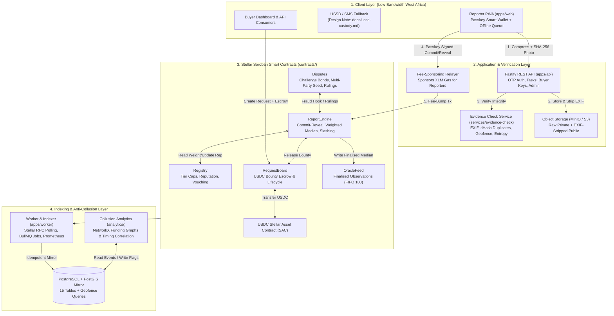

# MarketPulse Oracle: System Architecture

**Companion Specification:** `README.md` Section 5 (Architecture) & Section 8 (Smart contract design).

---

## 1. End-to-End Architecture Diagram

---

## 2. Trust & Privacy Boundaries

1. **Zero Personal Data On-Chain:** Phone numbers are salted and SHA-256 hashed immediately in `apps/api`. Raw EXIF-bearing photos are restricted in private storage while public copies have all EXIF/GPS tags stripped (`MockObjectStorage`). On-chain contracts store only 32-byte SHA-256 hashes, coarse 6–8 character market geohashes, and integer aggregates.
2. **Advisory Off-Chain Flags:** Neither `services/evidence-check` nor `analytics/` can unilaterally slash a reporter's stake. They emit structured advisory flags into the `flags` table to assist human arbiters and on-chain dispute panels (`contracts/disputes`).
3. **Non-Custodial Fee Sponsorship:** Reporters sign commitments using device-bound WebAuthn passkeys (`PasskeyWalletAccount`). The Relayer wraps transactions in fee-bump envelopes so reporters never need XLM.
